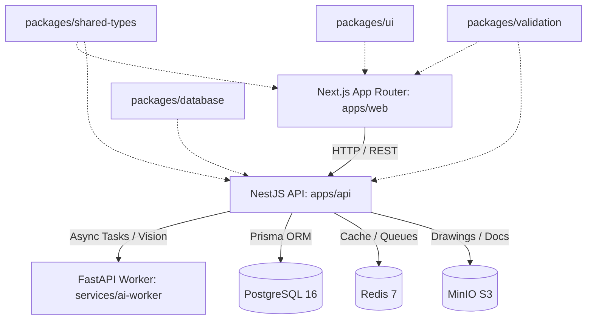

# BuildMind AI v5.0 — System Architecture Document

## 1. Monorepo Architecture Overview
BuildMind AI v5.0 employs a modern **modular monorepo** managed via **pnpm workspaces**. This architecture provides strict dependency isolation, code reuse, and atomic versioning without the operational burden of microservice sprawl.



---

## 2. Workspace Directory Layout
```
buildmind/
├── apps/
│   ├── web/                     # Next.js 15, App Router, React 19, Tailwind CSS, Navy/Teal theme
│   └── api/                     # NestJS 10, TypeScript, /api/v1 prefix, domain modules
├── services/
│   └── ai-worker/               # FastAPI, Python 3.14, computer vision & NLP service boundaries
├── packages/
│   ├── config/                  # Shared tsconfig, eslint, code style configs
│   ├── database/                # Prisma ORM, PostgreSQL schema, migrations, typed client
│   ├── shared-types/            # Canonical domain types, enums, DTO contracts, API envelopes
│   ├── ui/                      # Navy/teal design tokens, typography, brand primitives
│   └── validation/              # Zod validation schemas for API inputs & entities
├── infrastructure/
│   ├── docker/                  # Dockerfiles for api, ai-worker, and web
│   └── docker-compose.yml       # PostgreSQL 16, Redis 7, MinIO S3-compatible service stack
└── docs/
    ├── requirements/            # Scope specification & capability catalog
    ├── architecture/            # Architecture blueprints & ADRs
    ├── development/             # Local developer setup guides
    └── api/                     # API boundaries & protocol specifications
```

---

## 3. Core Architectural Principles

### 3.1 Bounded Domain Organization (No Microservice Sprawl)
The backend (`apps/api`) organizes business logic into modular domains within NestJS (`organizations`, `users`, `projects`, `qs`), keeping domain boundaries clean while avoiding distributed system overhead during initial development.

### 3.2 Deterministic Financial Calculations vs. AI Proposals
- **AI Proposals**: Computer vision element extraction (AF-01), drawing conflict suggestions (AF-03), and copilot recommendations (AF-04) are treated as **unverified proposals**.
- **Deterministic Engine**: All quantities, rate build-ups, BOQ line totals, valuations, and variation accounts are computed using strict decimal arithmetic. AI never silently mutates commercial numbers.

### 3.3 Multi-Tenant Boundary & Ownership Hierarchy
- Every project belongs to an `Organization`.
- Users access projects through explicit `Membership` roles (`GLOBAL_ADMIN`, `COMMERCIAL_DIRECTOR`, `SENIOR_QS`, `QS_ENGINEER`, `ESTIMATOR`, `AUDITOR`, `VIEWER`).
- All data records are tagged with `organizationId` and `createdById`.

### 3.4 Audit Trail & Source Provenance
- Every takeoff measurement links back to a specific `drawingId`, `revisionId`, layer, and bounding coordinate.
- Every analytical rate links to standard norms (CIDA / MasterFormat) or verified supplier quotations.
- Every payment certificate retains immutable evidence of work done and retention deductions.

### 3.5 Regional Calibration & Standards
- Primary calibration: **Sri Lanka** (SLS 573:1999 standard measurement method, CIDA SBD-01/02/03 contract terms, LKR currency).
- International readiness: Pluggable engines for **CESMM4**, **NRM2**, **SMM7**, **POMI**, and **FIDIC**.
