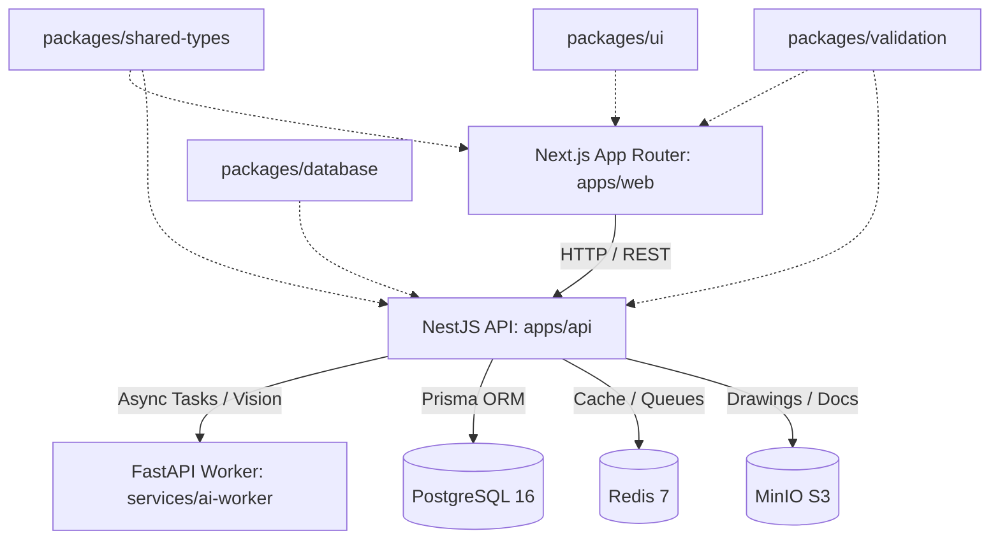
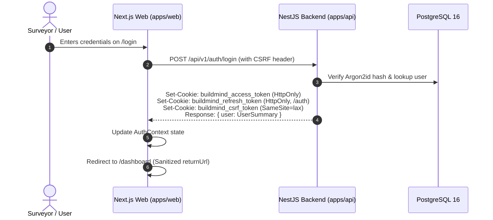

# BuildMind AI v5.0 — System Architecture Document

## 1. Monorepo Architecture Overview
BuildMind AI v5.0 employs a modern **modular monorepo** managed via **pnpm workspaces**. This architecture provides strict dependency isolation, code reuse, and atomic versioning without the operational burden of microservice sprawl.



---

## 2. Workspace Directory Layout
```
buildmind/
├── apps/
│   ├── web/                     # Next.js 15, App Router, React 19, Tailwind CSS, Navy/Teal theme
│   └── api/                     # NestJS 10, TypeScript, /api/v1 prefix, domain modules
├── services/
│   └── ai-worker/               # FastAPI, Python 3.14, computer vision & NLP service boundaries
├── packages/
│   ├── config/                  # Shared tsconfig, eslint, code style configs
│   ├── database/                # Prisma ORM, PostgreSQL schema, migrations, typed client
│   ├── shared-types/            # Canonical domain types, enums, DTO contracts, API envelopes
│   ├── ui/                      # Navy/teal design tokens, typography, brand primitives
│   └── validation/              # Zod validation schemas for API inputs & entities
├── infrastructure/
│   ├── docker/                  # Dockerfiles for api, ai-worker, and web
│   └── docker-compose.yml       # PostgreSQL 16, Redis 7, MinIO S3-compatible service stack
└── docs/
    ├── requirements/            # Scope specification & capability catalog
    ├── architecture/            # Architecture blueprints & ADRs
    ├── development/             # Local developer setup guides
    └── api/                     # API boundaries & protocol specifications
```

---

## 3. Core Architectural Principles

### 3.1 Bounded Domain Organization (No Microservice Sprawl)
The backend (`apps/api`) organizes business logic into modular domains within NestJS (`organizations`, `users`, `projects`, `qs`), keeping domain boundaries clean while avoiding distributed system overhead during initial development.

### 3.2 Deterministic Financial Calculations vs. AI Proposals
- **AI Proposals**: Computer vision element extraction (AF-01), drawing conflict suggestions (AF-03), and copilot recommendations (AF-04) are treated as **unverified proposals**.
- **Deterministic Engine**: All quantities, rate build-ups, BOQ line totals, valuations, and variation accounts are computed using strict decimal arithmetic. AI never silently mutates commercial numbers.

### 3.3 Multi-Tenant Boundary & Ownership Hierarchy
- Every project belongs to an `Organization`.
- Users access projects through explicit `Membership` roles (`GLOBAL_ADMIN`, `COMMERCIAL_DIRECTOR`, `SENIOR_QS`, `QS_ENGINEER`, `ESTIMATOR`, `AUDITOR`, `VIEWER`).
- All data records are tagged with `organizationId` and `createdById`.

### 3.4 Audit Trail & Source Provenance
- Every takeoff measurement links back to a specific `drawingId`, `revisionId`, layer, and bounding coordinate.
- Every analytical rate links to standard norms (CIDA / MasterFormat) or verified supplier quotations.
- Every payment certificate retains immutable evidence of work done and retention deductions.

### 3.5 Regional Calibration & Standards
- Primary calibration: **Sri Lanka** (SLS 573:1999 standard measurement method, CIDA SBD-01/02/03 contract terms, LKR currency).
- International readiness: Pluggable engines for **CESMM4**, **NRM2**, **SMM7**, **POMI**, and **FIDIC**.


---

## 4. Phase 2A: Authentication Architecture & Security Specification

### 4.1 Authentication Engine Principles
1. **Zero Plaintext Storage**: Passwords are hashed using **Argon2id** (`m=65536, t=3, p=1`). Refresh tokens, email verification tokens, and password reset tokens are stored strictly as **SHA-256** digests.
2. **Rotating Refresh Tokens with Reuse Detection**: Each call to `/api/v1/auth/refresh` invalidates the previous session and creates a new session in the same token family (`familyId`). If an attacker presents an already-rotated refresh token, the system detects a token replay/theft event, invalidates all sessions for that user across all devices, and logs an alert.
3. **Session Revocation & Multi-Session Support**: Users can have multiple concurrent sessions across different devices (desktop, mobile). Users can log out of their current device (`/auth/logout`) or revoke all active sessions (`/auth/logout-all`).
4. **HttpOnly Cookie Architecture**: To eliminate token exfiltration vulnerabilities common with browser `localStorage`, browser clients receive HttpOnly, SameSite cookies with strict domain and path scoping.
5. **Audit Logging**: All security events (`LOGIN_SUCCESS`, `LOGIN_FAILED`, `REGISTER_SUCCESS`, `LOGOUT`, `LOGOUT_ALL`, `REFRESH_SUCCESS`, `REFRESH_REUSE_DETECTED`, `PASSWORD_CHANGE`, `PASSWORD_RESET_REQUESTED`, `PASSWORD_RESET_COMPLETED`, `EMAIL_VERIFIED`) are persisted to `auth_audit_events` with IP address, user-agent, and sanitized metadata (passwords and tokens are strictly excluded).
6. **Email Transport Abstraction**: Verification and password reset links are dispatched through `EmailService`. In local development/testing, messages are held in a safe local delivery queue without communicating with external mail relays or exposing tokens in production logs.
7. **Rate Limiting & Brute-Force Protection**: Sensitive endpoints (`/auth/login`, `/auth/forgot-password`, `/auth/resend-verification`) are rate-limited via `@nestjs/throttler` (e.g. 10 attempts/min on login) to protect against credential stuffing and brute-force attacks.


---

## 5. Phase 2B: Frontend Authentication & Browser Integration Specification

### 5.1 Browser Session Architecture
BuildMind AI v5.0 eliminates browser storage security risks (`localStorage`/`sessionStorage` token theft via XSS) by adopting an **HttpOnly cookie session architecture**:



### 5.2 Double-Submit CSRF Defense
To prevent Cross-Site Request Forgery on cookie-authenticated mutating requests:
1. The backend issues a random 48-hex character token in the non-HttpOnly cookie `buildmind_csrf_token` on `GET /api/v1/auth/csrf` or any initial safe request.
2. The browser API client (`apps/web/src/lib/api-client.ts`) extracts `buildmind_csrf_token` from `document.cookie` and transmits it in the `X-CSRF-Token` HTTP header on all `POST`, `PUT`, `PATCH`, and `DELETE` requests.
3. The backend `CsrfGuard` verifies:
   - Request `Origin` header matches explicit trusted origins (`http://localhost:3000`).
   - Request header `x-csrf-token` strictly matches cookie `buildmind_csrf_token`.
   - Mismatches or untrusted origins are rejected with `403 Forbidden`.

### 5.3 Silent Token Refresh & Concurrency Mutex
When an authenticated request returns `401 Unauthorized`, `apiClient` intercepts the error and executes a single silent refresh via `POST /api/v1/auth/refresh`. A concurrency promise mutex ensures multiple simultaneous 401s coalesce into a single refresh request, preventing refresh token rotation race conditions.

### 5.4 Route Protection & Open Redirect Mitigation
- **Middleware Check**: `apps/web/src/middleware.ts` guards all commercial workspace routes (`/dashboard`, `/takeoff`, `/projects`, `/settings`, etc.). If session cookies are absent, the visitor is redirected to `/login?returnUrl=<pathname>`.
- **Open Redirect Neutralization**: The `sanitizeReturnUrl` utility strictly enforces relative path redirects (`/path`), rejecting absolute schemes (`http:`, `https:`), protocol-relative prefixes (`//`), or backslashes (`\`), defaulting safely to `/dashboard`.
- **Flash Mitigation**: `AppShell` renders an accessible dark navy loading skeleton while the session state is being verified by `useAuth()`, ensuring protected commercial data never flashes prior to authorization confirmation.

### 5.5 Local Email Development Testing Workflow
In development, outgoing emails are captured in the server-side queue:
1. When registering or requesting password reset, a verification or reset token is generated.
2. The user can view the token status in the server log or query `GET /verify-email?token=<token>`.
3. Account verification state is instantly reflected in `/settings/profile` and the Header identity badge.
